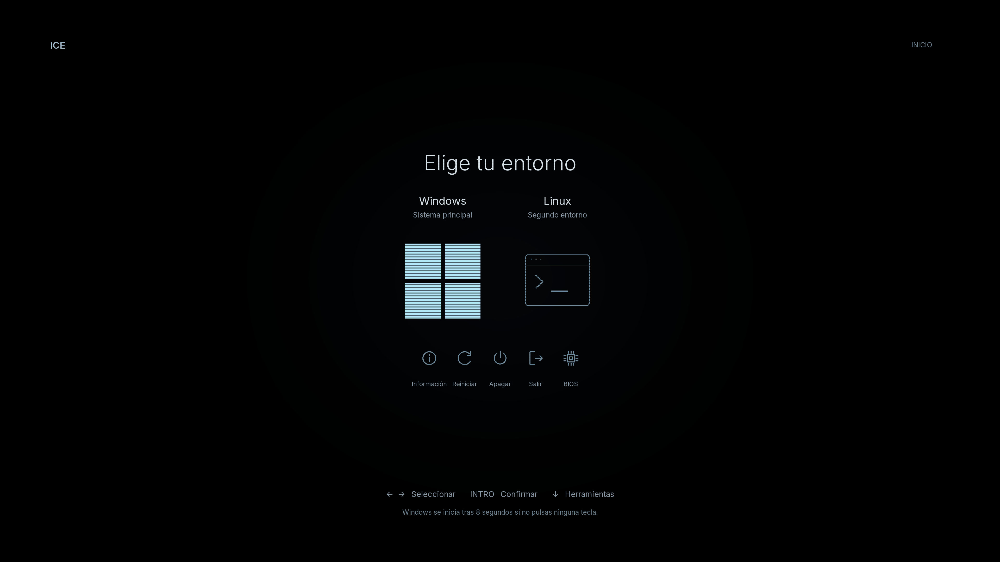

# ICE — minimal rEFInd theme

Black, ice blue, subtle scanlines and keyboard selection that brightens the glyph itself, without a border or glow. [Full Spanish guide](README.md).



**[Download v1.0.0](https://github.com/PapiGECode/refind-ice/releases/download/v1.0.0/refind-ice-v1.0.0.zip)** · **[Interactive demo](https://papigecode.github.io/refind-ice/)** · [All releases](https://github.com/PapiGECode/refind-ice/releases)

Published by [PapiGECode](https://github.com/PapiGECode).

## Package

Native 1080p and 4K assets, Spanish prebuilt labels, an English generator preset, a local interactive preview, source code, redistributable fonts and licenses. Prebuilt assets expect exactly two OS entries and five tools. The default examples show Windows and Linux; the Linux path is intentionally a placeholder. No personal hardware data, EFI executables, BCD stores, recovery images or signing keys are supplied.

## Use with an existing working rEFInd installation

1. Back up your current rEFInd configuration and theme. Keep a working original boot-manager entry accessible from the firmware selector and any required disk-encryption recovery key.
2. Pick a resolution supported by your **firmware GOP**, not merely by Windows or your monitor. These assets do not automatically adapt to a different fallback resolution.
3. Copy `1080p/theme` or `4k/theme` into `themes/ice` beside your existing rEFInd executable.
4. Adapt that variant's `refind.conf.example`. Replace the Linux placeholder with an already working loader path, and specify `volume` if needed. Verify all loader paths before using the configuration. Do not create a fake second OS entry on a single-OS machine.
5. Absolute icon paths assume `/EFI/refind/`. Adjust for your real installation directory. Keep `icon` before `volume`, as generated. Theme file references are relative to the rEFInd directory.
6. Merge the adapted entries/options into your configuration, removing duplicate entries/theme includes. Preserve manual scanning and the exact entry/tool order; add the theme include after settings it must override. Try from the firmware boot selector before making it your default.
7. If an entry/tool is missing or extra, regenerate the assets for the actual visible set. To undo, use the original boot manager and restore your saved configuration. If 4K is unsupported, restore and try 1080p.

The brightness effect uses masks positioned against a static background. Changing the resolution, entry count/order or tool availability requires regeneration. This is not an arbitrary auto-detection layout.

## Generate a different layout

Python 3.10+, in a virtual environment:

```sh
python -m pip install -r requirements.txt
python source/render.py --scale 2 --config presets/en.json --output my-ice-4k
python source/render.py --scale 1 --config presets/windows-only.json --output my-ice-1080p
```

Edit a copy of a JSON preset. `brand` changes the header; `refind_dir` specifies the EFI directory; `timeout` controls auto-boot of the first entry (0 waits indefinitely). `entries` supports 1–4 entries with short titles, subtitles, a `windows` or `terminal` glyph, an existing EFI loader path, OS type and optional volume. `tools` lists the actual available tools. Only add `mok_tool` if a working MOK manager is already detected. Remove `firmware` and regenerate if unavailable. `info` accepts up to four static label/value pairs; it is empty by default. `labels` translates the background text, not rEFInd's internal dialogs.

The generator requires a new/empty output folder and never installs files or changes firmware. It outputs `theme/`, a configuration example, simulated selection previews, layout coordinates and hashes. The bundled web preview shows the distributed preset's real VM screenshots, not subsequent custom generations. Review regenerated text for clipping. The renderer contains the palette and geometry if you want to modify them.

## Validation and limits

Visual tests: rEFInd 0.14.2, QEMU/OVMF, Secure Boot enabled in the test VM, both resolutions, two entries and five tools. All seven keyboard selections were checked; changing selection changed pixels only within the two relevant icon rectangles. Test loaders populated the menu but were not executed; another person's OS boot is not validated. Other generated entry/tool counts require target-machine checks.

The theme does not implement recovery, live sensor telemetry, HDR, animations, Secure Boot signing or anticheat certification. Existing boot-chain trust and firmware support remain prerequisites. No Secure Boot key change is needed just to copy artwork into an already compatible installation. Physical firmware compatibility must be checked per machine.

## Credits and license

MIT for original project code/artwork. Inspired by [FaeArtz/finn-term](https://github.com/FaeArtz/refind-finn-term); original MIT notice retained. Inter and JetBrains Mono are bundled under SIL OFL 1.1; see `licenses/`. No Segoe UI font redistribution. Windows marks belong to Microsoft; no affiliation. rEFInd itself is not bundled.

[rEFInd configuration](https://www.rodsbooks.com/refind/configfile.html) · [rEFInd themes](https://www.rodsbooks.com/refind/themes.html)
