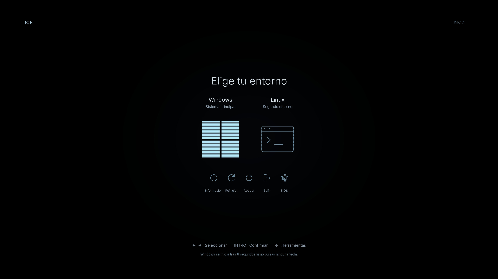

# ICE — tema minimalista para rEFInd

Negro, azul hielo y selección que ilumina el propio icono. Sin recuadros ni halos.



[English instructions](README.en.md) · [Demo interactiva](https://papigecode.github.io/refind-ice/) · [Licencia MIT](LICENSE)

## Descargar

**[Descargar ICE v1.0.0 (ZIP)](https://github.com/PapiGECode/refind-ice/releases/download/v1.0.0/refind-ice-v1.0.0.zip)** · [Todas las versiones](https://github.com/PapiGECode/refind-ice/releases)

Descomprime el paquete, elige 1080p o 4K y sigue la instalación manual de esta página. Para ver el diseño sin instalar nada, abre la demo. El proyecto lo publica [PapiGECode](https://github.com/PapiGECode).

## Qué incluye

- Recursos nativos a **1920 × 1080** y **3840 × 2160**, formato 16:9.
- Dos entradas de ejemplo: Windows y Linux. Nombres, cantidad de entradas y herramientas configurables con el generador.
- Cinco herramientas: información, reiniciar, apagar, salir y firmware. Claves/MOK es opcional y requiere una instalación compatible.
- Inicio automático de la primera entrada tras ocho segundos. Una tecla cancela la espera; `timeout: 0` espera indefinidamente.
- Textos dibujados en español y un preset inglés para generar otra versión.
- Tipografías redistribuibles Inter y JetBrains Mono, código fuente y licencias.
- Sin nombres personales, datos de hardware del creador, claves, cargadores EFI, BCD ni imágenes de recuperación.

**Es un tema para una instalación de rEFInd que ya funciona. No instala rEFInd, Windows, Linux ni un entorno de recuperación.** Tampoco traduce todos los diálogos internos de rEFInd: los rótulos principales están dibujados en el fondo.

## Antes de aplicarlo

1. Comprueba que puedes arrancar tus sistemas y volver al gestor original mediante el selector de arranque del firmware. Conserva esa entrada.
2. Guarda una copia de tu `refind.conf` y tema actual fuera de la partición EFI. Si utilizas cifrado con recuperación, conserva su clave antes de modificar el arranque.
3. Elige una resolución que el **firmware UEFI/GOP** ofrezca. Que Windows funcione a 4K no demuestra que el firmware lo soporte. El tema no se adapta automáticamente a una resolución distinta: si 4K falla, vuelve al gestor original y cambia al paquete 1080p.
4. Los archivos preparados esperan **exactamente dos entradas principales y cinco herramientas**, en el orden del ejemplo. Si faltan o sobran entradas, utiliza el generador. No mezcles recursos de diferentes resoluciones.

El brillo utiliza máscaras alineadas con las posiciones del menú. El número, orden y tamaño de iconos deben coincidir con la configuración real. No es un tema de autodetección para un número arbitrario de sistemas.

## Instalación manual

Estas instrucciones presuponen acceso a la partición EFI y una instalación existente de rEFInd; no incluyen comandos para modificar particiones o el orden de arranque.

1. Escoge `1080p` o `4k`.
2. Copia su carpeta `theme` como **`themes/ice` dentro de la carpeta que contiene el ejecutable de rEFInd**. Ejemplo habitual: `/EFI/refind/themes/ice/`.
3. Lee `refind.conf.example` de esa resolución. **No lo copies sin adaptarlo**: la entrada Linux tiene deliberadamente una ruta de marcador que no funciona. Identifica los cargadores y, si procede, volúmenes reales a partir de tu configuración que ya arranca correctamente.
4. El ejemplo usa `/EFI/refind/` para las rutas absolutas de los iconos. Si tu instalación está en otra carpeta, cambia esas rutas. Las rutas de `theme.conf` son relativas a la carpeta de rEFInd y se mantienen como `themes/ice/...`.
5. Integra las opciones y entradas del ejemplo en tu `refind.conf`, evitando duplicarlas con otras entradas manuales o temas. Incluye `include themes/ice/theme.conf` después de las opciones que deba sustituir. Respeta `scanfor manual`, el orden de las entradas y la lista `showtools` del ejemplo.
6. Mantén las líneas `icon` antes de `volume` tal como las genera el programa. Si el cargador está en otro volumen, utiliza el identificador correcto en `volume`; no deduzcas rutas EFI de las letras de unidad de Windows.
7. Revisa que las dos rutas de cargadores existan, que los cinco botones aparezcan y que el texto corresponda con lo que se ejecutará. Prueba rEFInd desde el selector del firmware antes de convertirlo en tu opción habitual.

Si solo tienes Windows, **no conserves una entrada Linux ficticia**: genera un tema de una entrada con `presets/windows-only.json`. Para un acceso a recuperación, sustituye la segunda entrada por un cargador de recuperación previamente configurado y probado. Una etiqueta «Recuperación» por sí sola no crea ese entorno.

Para deshacer el cambio, vuelve al gestor original desde el selector del firmware y restaura tu `refind.conf` anterior. No necesitas cambiar las claves de Secure Boot para retirar este tema.

## Personalización

Requiere Python 3.10 o posterior. Ejecuta desde la carpeta del proyecto; el generador solo escribe recursos en una carpeta nueva y **no toca la EFI, la BIOS ni el arranque**.

```sh
python -m venv .venv
# Activa el entorno: Windows .venv\Scripts\activate; Linux/macOS source .venv/bin/activate
python -m pip install -r requirements.txt
python source/render.py --scale 1 --config presets/es.json --output mi-tema-1080p
python source/render.py --scale 2 --config presets/en.json --output my-theme-4k
python source/render.py --scale 1 --config presets/windows-only.json --output solo-windows
```

Copia un preset y edita:

- `brand`: nombre de la esquina superior izquierda.
- `refind_dir`: carpeta EFI real de rEFInd, por ejemplo `/EFI/refind`.
- `timeout`: segundos; `0` desactiva el arranque automático. La primera entrada es la predeterminada.
- `entries`: de una a cuatro entradas, con título corto, subtítulo, `glyph` (`windows` o `terminal`), `loader`, `ostype` y opcionalmente `volume`. Conserva sus rutas de arranque conocidas; no las inventes.
- `tools`: herramientas disponibles, en orden. Si tu firmware no muestra `firmware`, quítala y regenera. Añade `mok_tool` solo si rEFInd ya detecta un gestor MOK válido. El paquete no lo suministra.
- `info`: hasta cuatro campos estáticos, por ejemplo `[{"label":"PROCESADOR","value":"Tu procesador"}]`. Vacío de fábrica. No hay telemetría en tiempo real.
- `labels`: traducción de los textos del fondo. Usa títulos cortos y comprueba la vista previa si cambias textos.

Las salidas contienen `theme/`, un ejemplo de configuración, posiciones, hashes y vistas simuladas `preview-*.png`. La web incluida muestra las capturas **reales de VM** `vm-*.png` del preset distribuido, no se actualiza automáticamente al generar otro tema. Los colores y los trazos se pueden editar en `source/render.py` y regenerar.

## Compatibilidad y pruebas

Probado visualmente con rEFInd **0.14.2**, QEMU/OVMF y Secure Boot en la VM: 1080p y 4K, dos entradas y cinco herramientas, con las siete selecciones por teclado. Se verificó que al cambiar de selección solo cambiasen píxeles dentro de los iconos implicados. Los cargadores usados para poblar el menú de prueba no se ejecutaron: estas capturas no prueban el inicio de Windows o Linux de otra persona.

El generador permite otros recuentos, pero la validación visual en firmware de esta distribución se limita al preset de dos entradas/cinco herramientas. Los recursos generados deben comprobarse en el equipo de destino.

El tema **no añade compatibilidad con Secure Boot ni certificación para antitrampas**. Eso depende de la instalación existente de rEFInd, sus cargadores, claves y firmware. No hace falta desactivar Secure Boot ni instalar certificados para copiar unos recursos gráficos en una instalación ya compatible. No se incluyen ejecutables firmados ni claves privadas.

La pantalla 4K física, el soporte de cada firmware y la disponibilidad de sus herramientas deben verificarse en cada equipo. No incluye animaciones, HDR ni lectura de sensores.

## Créditos

Diseño surgido de una personalización inspirada en [finn-term de FaeArtz](https://github.com/FaeArtz/refind-finn-term). Se conserva su aviso MIT en `licenses/finn-term-MIT.txt`. Iconos geométricos y generador incluidos en este proyecto bajo MIT. [rEFInd](https://www.rodsbooks.com/refind/) no se redistribuye ni está afiliado al proyecto.

[Inter](https://github.com/rsms/inter) y [JetBrains Mono](https://github.com/JetBrains/JetBrainsMono): SIL OFL 1.1; textos completos en `licenses/`. La marca y el símbolo Windows pertenecen a Microsoft; su uso identifica el sistema, no implica afiliación. No se redistribuye Segoe UI.

Referencias: [configuración de rEFInd](https://www.rodsbooks.com/refind/configfile.html), [temas de rEFInd](https://www.rodsbooks.com/refind/themes.html).
